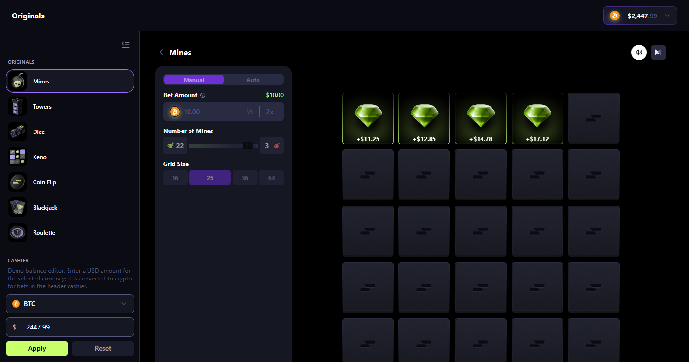
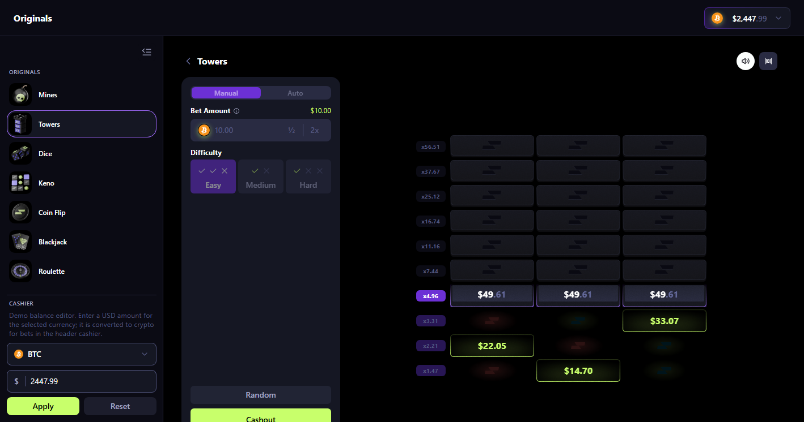
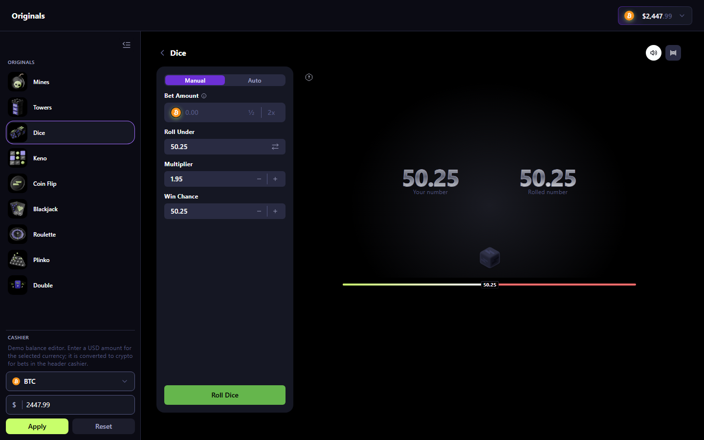
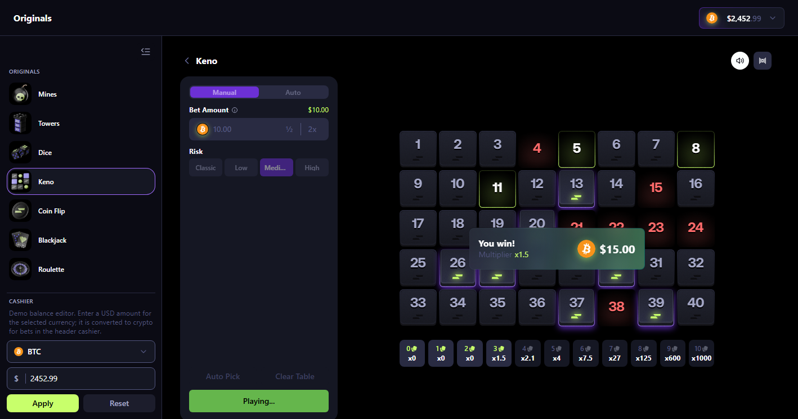
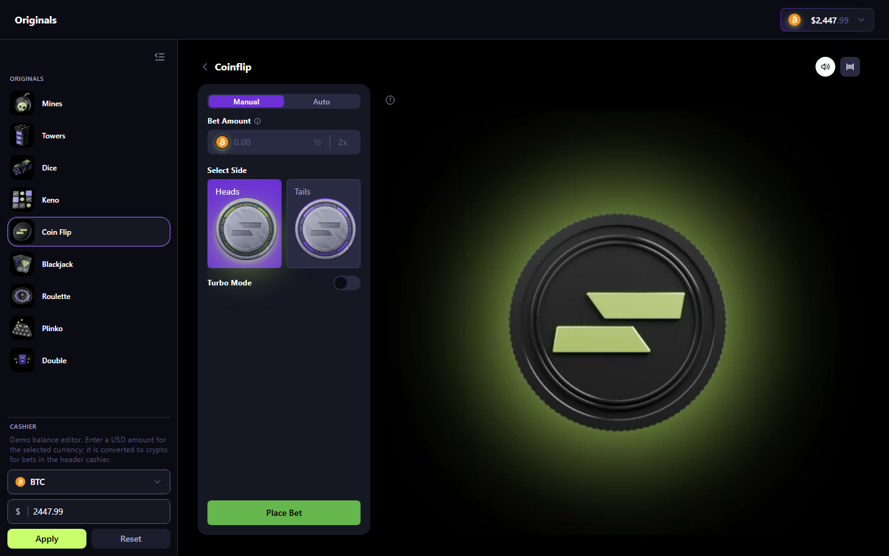
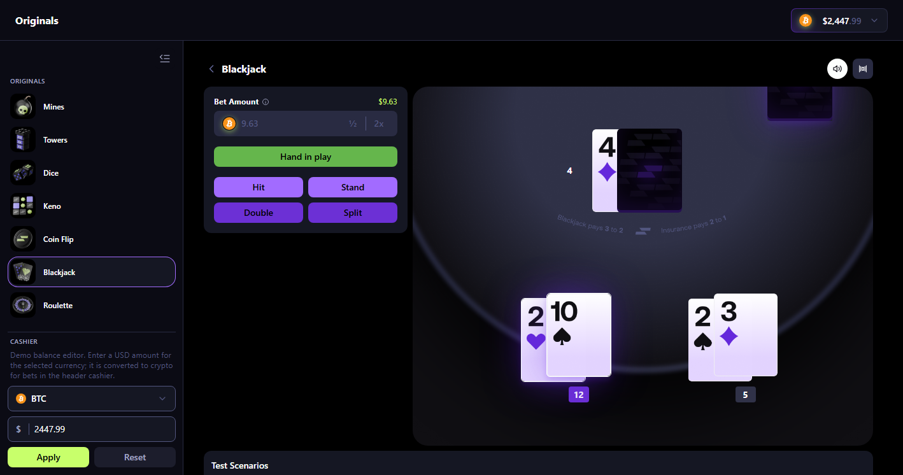
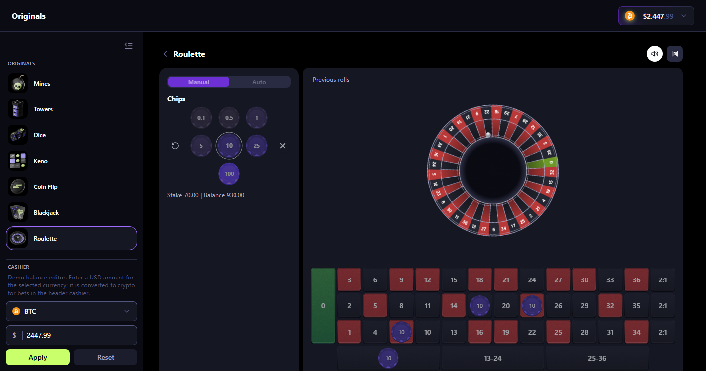
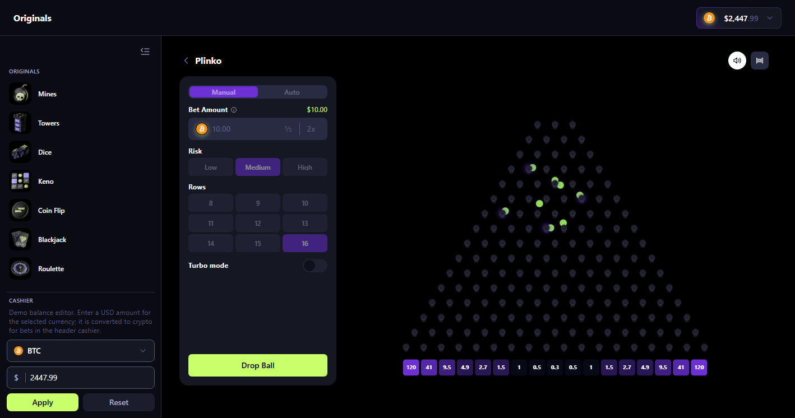
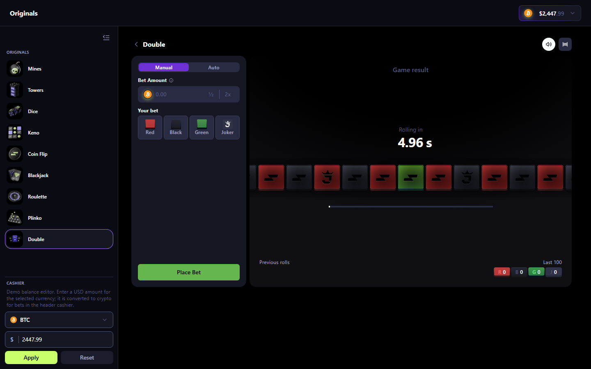

# Casino Originals

A frontend-only demo of in-house casino originals: nine playable games in one Next.js app, with a shared wallet, autobet, theatre mode, and Storybook for the UI.

There is no backend, authentication, or websocket. Outcomes are resolved locally so you can exercise the full player shell — betting, payouts, sounds, and layout — without a live wagering stack.

---

## Games

Every title is available in the app sidebar at `/games/<id>`. Shared across most games: demo wallet and cashier, manual / autobet modes, stop conditions, volume, theatre layout, and a win overlay.

| Game | Route | What it is | What you can do |
| --- | --- | --- | --- |
| **Mines** | `/games/mines` | Grid of tiles with hidden mines | Choose grid size and mine count, pick tiles, cash out, or hit a mine |
| **Towers** | `/games/towers` | Climb a tower, row by row | Pick a safe cell per floor, advance, cash out, or hit a bomb |
| **Dice** | `/games/dice` | Roll against a target | Set roll under/over, target, win chance, and multiplier; watch the cube settle |
| **Keno** | `/games/keno` | Draw 10 numbers from 40 | Pick up to 10 spots (or auto-pick), choose risk, and match the draw |
| **Coin Flip** | `/games/coinflip` | Heads or tails | Pick a side, optional turbo, and play the coin animation |
| **Blackjack** | `/games/blackjack` | Standard table blackjack | Deal, hit, stand, double, split, and insurance against a local dealer |
| **Roulette** | `/games/roulette` | European-style wheel | Place inside/outside bets, spin, and settle from the wheel result |
| **Plinko** | `/games/plinko` | Ball drop through pins | Choose risk and row count, optional turbo, drop balls into multiplier buckets |
| **Double** | `/games/double` | Color / joker strip | Pick red, black, or joker on a scrolling strip and settle the round |

The home page (`/`) redirects to Coin Flip.

---

## Game Previews

### Mines (`/games/mines`)
Grid-based game where players uncover tiles to reveal gems or avoid hidden mines. Features configurable grid dimensions (4×4 to 8×8), customizable mine counts, and real-time cashout multipliers.



### Towers (`/games/towers`)
Floor-by-floor tower climb. Choose one safe cell on each level to climb higher with increasing payout multipliers, or cash out before hitting a skull. Supports Easy, Medium, and Hard difficulty presets.



### Dice (`/games/dice`)
Classic high/low dice roll with an interactive target slider. Supports roll-under/roll-over toggles, real-time win probability and multiplier calculations, and animated 3D dice rolls.



### Keno (`/games/keno`)
40-number lottery board. Pick up to 10 numbers manually or use Auto-Pick, choose between Classic, Low, Medium, or High risk profiles, and watch the 10-ball draw settle hits and payouts.



### Coin Flip (`/games/coinflip`)
Fast-paced two-sided coin toss. Choose Heads or Tails, toggle Turbo mode for instantaneous results, or enjoy physics-driven 3D spinning coin animations.



### Blackjack (`/games/blackjack`)
Table blackjack against a dealer. Complete rules support: Deal, Hit, Stand, Double Down, Split pair, and Insurance against a dealer Ace. Includes preset test scenarios to verify house rules and payouts.



### Roulette (`/games/roulette`)
European single-zero roulette with chip-based wagering. Place inside and outside bets on the interactive betting felt, spin the realistic 3D wheel, and track roll history.



### Plinko (`/games/plinko`)
Peg-board physics drop game. Drop balls through pin pyramids into multiplier pockets. Customize peg row count (8–16 rows), risk levels (Low, Medium, High), and Turbo drop mode.



### Double (`/games/double`)
Continuous sliding strip game. Bet on Red (2x), Black (2x), or Green/Joker (14x), with synced round timers, smooth strip rolling animations, and recent outcomes tracking.



---

## Features

- **Frontend-Only Architecture**: All game mechanics, random outcomes, and balance tracking run client-side — no live backend or WebSocket connection required.
- **Demo Cashier & Wallet**: Manage demo balances in BTC, ETH, and USDT with USD value conversions and an instant balance editor.
- **Autobet System**: Configurable autobet engine with stop-on-profit, stop-on-loss, and dynamic bet adjustments on win/loss.
- **Audio Experience**: Sound effects for game events (card shuffles, chip placements, wheel spins, dice rolls, coin flips, payouts) and shared win fanfare.
- **Theatre Mode**: Expand any game board to full theatre width for an immersive desktop experience.
- **Storybook UI Suite**: Component-level isolation and story testbeds for boards, controls, and configurations.

---

## Run locally

Requires [pnpm](https://pnpm.io).

```bash
pnpm install
pnpm dev
```

App: [http://localhost:3000](http://localhost:3000)

```bash
pnpm storybook
```

Storybook: [http://localhost:6006](http://localhost:6006) — isolated boards, configs, and composition stories.

```bash
pnpm build
pnpm start
```

Capture screenshots:

```bash
pnpm screenshots
```

Production build. On Vercel, import the repo with the **Next.js** preset; the default `pnpm build` command is enough.

---

## Stack

| Layer | Tools |
| --- | --- |
| App | Next.js 16, React 19, TypeScript |
| Styling | Tailwind CSS 4, design-system tokens |
| UI | Radix primitives, Framer Motion, Embla Carousel |
| Money | `bignumber.js` demo wallet (no real funds) |
| Audio | Howler / HTML audio, per-game cues and a shared win-modal sound |
| Docs / isolation | Storybook 10 (`@storybook/nextjs-vite`) |
