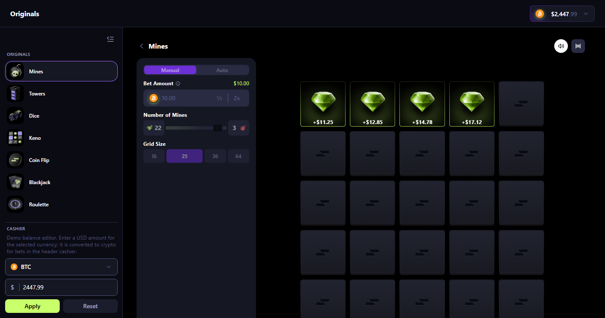
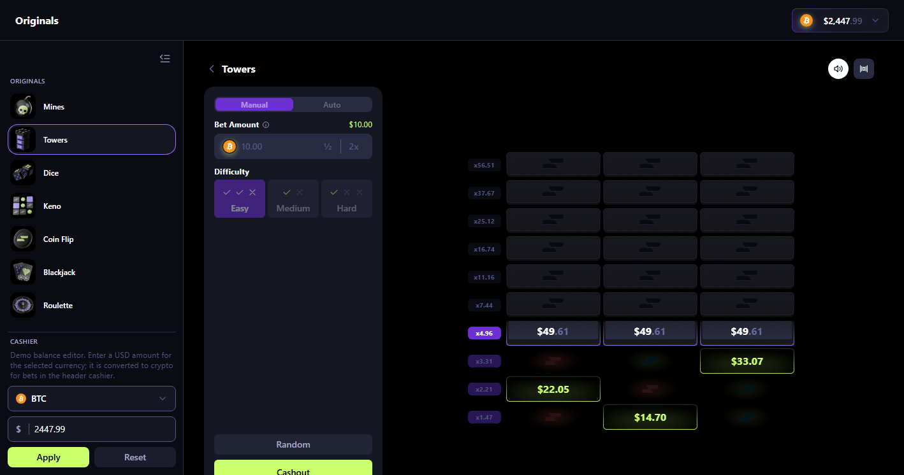
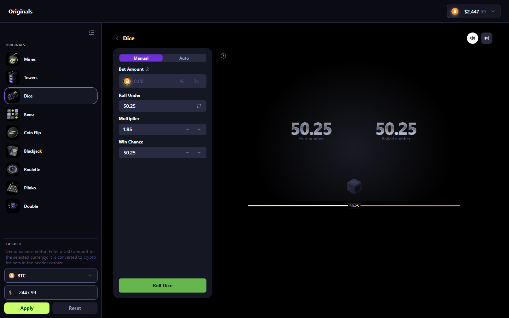
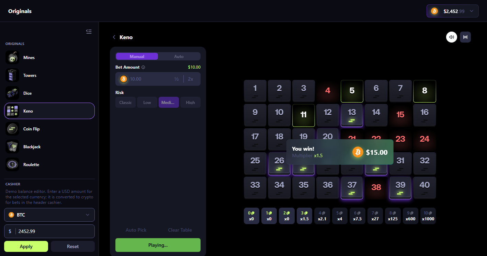
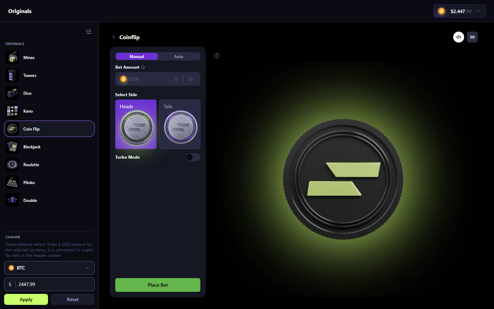
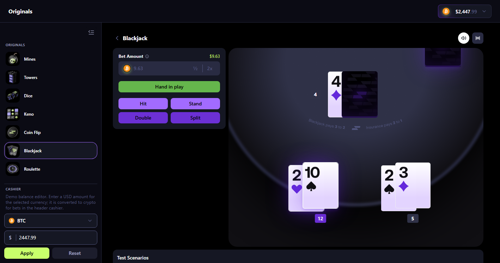
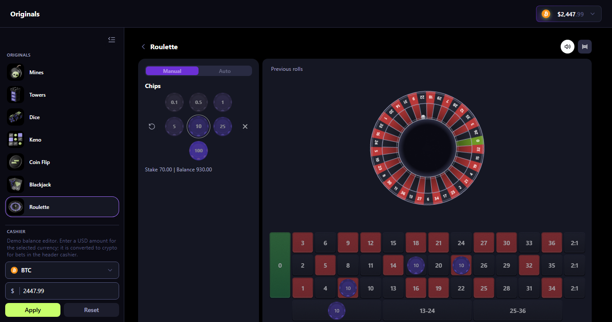
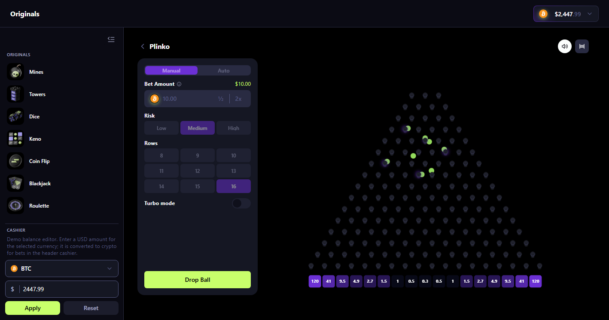
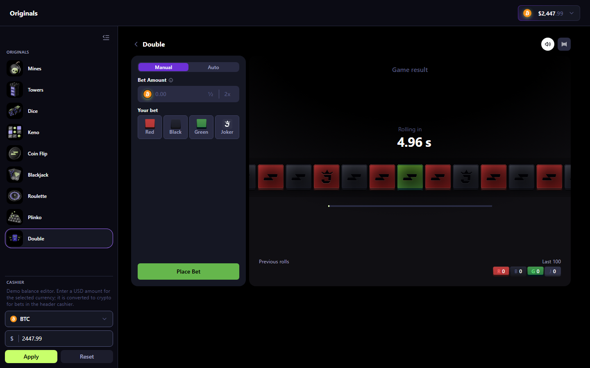

# Casino Originals

A demo of in-house casino originals: nine playable games in one Next.js app, powered by a real-time WebSocket backend (`server/index.ts`) with client-side offline fallback, shared wallet, autobet, theatre mode, and Storybook for the UI.

Outcomes can be resolved live over WebSocket (Socket.IO) or locally via client-side RNG, allowing you to exercise the full player shell — betting, real-time balance tracking, payouts, sounds, and layout — with or without a live server.

---

## Games

Every title is available in the app sidebar at `/games/<id>`. Shared across most games: live WebSocket connection badge (`SocketStatusBadge`), automatic offline fallback, demo wallet and cashier, manual / autobet modes, stop conditions, volume, theatre layout, and a win overlay.

| Game | Route | What it is | What you can do |
| --- | --- | --- | --- |
| **Mines** | `/games/mines` | Grid of tiles with hidden mines | Choose grid size (4x4 to 8x8) and mine count, pick tiles, cash out, or hit a mine (live socket or local RNG) |
| **Towers** | `/games/towers` | Climb a tower, row by row | Choose difficulty (Easy, Medium, Hard), pick safe cells, cash out, or hit a bomb (live socket or local RNG) |
| **Dice** | `/games/dice` | Roll against a target | Set roll under/over, target, win chance, and multiplier; watch the animated 3D cube settle |
| **Keno** | `/games/keno` | Draw 10 numbers from 40 | Pick up to 10 spots (or auto-pick), select risk profile (Classic, Low, Medium, High), match the draw |
| **Coin Flip** | `/games/coinflip` | Heads or tails | Pick a side, optional turbo, and play physics-driven 3D spinning coin animations |
| **Blackjack** | `/games/blackjack` | Standard table blackjack | Deal, hit, stand, double, split, and insurance against dealer with full table rules |
| **Roulette** | `/games/roulette` | European-style wheel | Place inside/outside chip bets with real-time balance sync, spin, and settle from the wheel result |
| **Plinko** | `/games/plinko` | Ball drop through pins | Choose risk and row count (8–16 rows), optional turbo, drop balls into multiplier buckets |
| **Double** | `/games/double` | Color / joker strip | Bet on red (2x), black (2x), or green/joker (14x) with synchronized room rounds, rolling strip, and history |

The home page (`/`) redirects to Coin Flip.

---

## Game Previews

### Mines (`/games/mines`)
Grid-based game where players uncover tiles to reveal gems or avoid hidden mines. Features configurable grid dimensions (4×4 to 8×8), customizable mine counts, real-time cashout multipliers, and live WebSocket or local gameplay.



### Towers (`/games/towers`)
Floor-by-floor tower climb. Choose one safe cell on each level to climb higher with increasing payout multipliers, or cash out before hitting a skull. Supports Easy, Medium, and Hard difficulty presets over WebSocket or local fallback.



### Dice (`/games/dice`)
Classic high/low dice roll with an interactive target slider. Supports roll-under/roll-over toggles, real-time win probability and multiplier calculations, and animated 3D dice rolls with live server or local RNG.



### Keno (`/games/keno`)
40-number lottery board. Pick up to 10 numbers manually or use Auto-Pick, choose between Classic, Low, Medium, or High risk profiles, and watch the 10-ball draw settle hits and payouts via socket or local engine.



### Coin Flip (`/games/coinflip`)
Fast-paced two-sided coin toss. Choose Heads or Tails, toggle Turbo mode for instantaneous results, or enjoy physics-driven 3D spinning coin animations with server-side or local resolution.



### Blackjack (`/games/blackjack`)
Table blackjack against a dealer. Complete rules support: Deal, Hit, Stand, Double Down, Split pair, and Insurance against a dealer Ace. Powered by a live table socket engine or local dealer fallback.



### Roulette (`/games/roulette`)
European single-zero roulette with chip-based wagering. Place inside and outside bets on the interactive betting felt, spin the realistic 3D wheel, track roll history, and enjoy real-time balance updates and up to 100 chip bets.



### Plinko (`/games/plinko`)
Peg-board physics drop game. Drop balls through pin pyramids into multiplier pockets. Customize peg row count (8–16 rows), risk levels (Low, Medium, High), and Turbo drop mode over WebSocket or local physics.



### Double (`/games/double`)
Continuous sliding strip game. Bet on Red (2x), Black (2x), or Green/Joker (14x), featuring synchronized multiplayer room rounds, countdown timers, smooth strip rolling animations, and recent outcomes tracking.



---

## Features

- **Hybrid WebSocket & Offline Architecture**: Real-time Socket.IO backend for all nine games (`server/index.ts`) with seamless, zero-downtime offline fallback to local RNG when disconnected.
- **Live Connection Status**: Visual status badge on each game header (`Connected` / `Offline`) indicating real-time WebSocket connectivity.
- **Demo Cashier & Wallet**: Manage demo balances in BTC, ETH, and USDT with real-time USD conversions and an instant balance editor.
- **Real-Time Stake & Balance Sync**: Available balance subtracts dynamically as chips/bets are placed on the table, and winnings are instantly credited upon round completion.
- **Mobile-Optimized UX**: Responsive layout positioning the game board above the configuration panel across all games on mobile devices.
- **Autobet System**: Configurable autobet engine with stop-on-profit, stop-on-loss, and dynamic bet adjustments on win/loss.
- **Audio Experience**: Sound effects for game events (card shuffles, chip placements, wheel spins, dice rolls, coin flips, payouts) and shared win fanfare.
- **Theatre Mode**: Expand any game board to full theatre width for an immersive desktop experience.
- **Storybook UI Suite**: Component-level isolation and story testbeds for boards, controls, and configurations.

---

## Run locally

Requires [pnpm](https://pnpm.io).

```bash
pnpm install
pnpm dev
```

App: [http://localhost:3000](http://localhost:3000)

Start WebSocket server (optional, for real-time multiplayer / server RNG):

```bash
pnpm ws
# or: pnpm server
```

Server runs on [http://localhost:3001](http://localhost:3001). Configure custom URLs via `NEXT_PUBLIC_SOCKET_URL`.

```bash
pnpm storybook
```

Storybook: [http://localhost:6006](http://localhost:6006) — isolated boards, configs, and composition stories.

```bash
pnpm build
pnpm start
```

Capture screenshots:

```bash
pnpm screenshots
```

Production build. On Vercel, import the repo with the **Next.js** preset; the default `pnpm build` command is enough (games automatically fall back to offline mode when the socket server is not running).

---

## Stack

| Layer | Tools |
| --- | --- |
| App | Next.js 16, React 19, TypeScript |
| Backend / Real-time | Socket.IO (v4), Node.js, `tsx` server (`server/index.ts`) |
| Styling | Tailwind CSS 4, design-system tokens |
| UI | Radix primitives, Framer Motion, Embla Carousel |
| Money | `bignumber.js` demo wallet (BTC, ETH, USDT with USD rates) |
| Audio | Howler / HTML audio, per-game cues and a shared win-modal sound |
| Docs / isolation | Storybook 10 (`@storybook/nextjs-vite`) |
